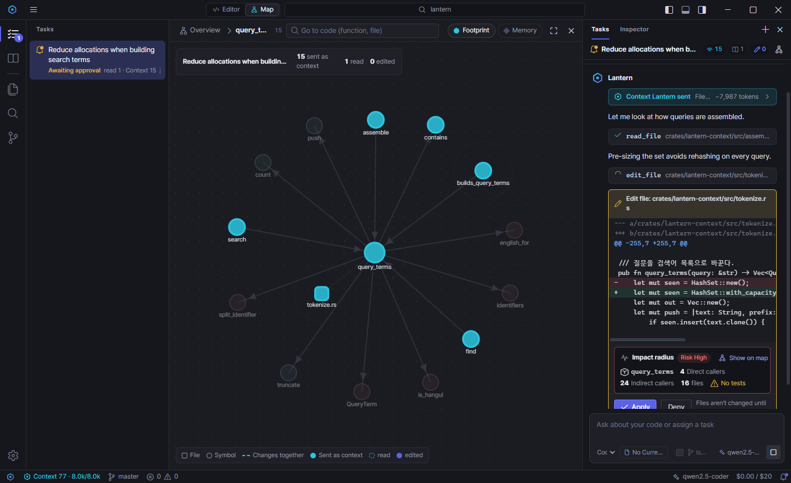

# Lantern IDE

**An AI code editor that shows you what the agent sees, what it changes, and how far the change reaches.**

[한국어](README.ko.md) · Windows beta · Apache-2.0 · Bring your own model (Claude, GPT, Gemini, DeepSeek, Grok, Mistral, Groq, OpenRouter, Ollama, LM Studio, any OpenAI-compatible API)



> **Beta.** Lantern is young software built by one developer. Windows is the tested platform; macOS and Linux build in CI but have not been used day to day. Expect rough edges and please [report them](https://github.com/Lantern-IDE/lantern/issues/new/choose).

## Why another AI editor?

Most AI editors are organised around files and a chat box. Once you let an agent edit code, the questions change: *what did it look at, what did it touch, and what else will break?* Lantern is organised around those questions.

- **Code map.** The centre of the window switches between the editor and a live map of your code (folders → files → symbols, calls, and files that usually change together).
- **Impact radius on every edit.** Before you approve an agent's edit, the card shows the symbols it touches, direct and indirect callers, the tests that cover them (or that there are none), and a risk level. One click shows it on the map.
- **Agent footprint.** Each task records what was sent as context, what the agent read, and what it edited, and paints it on the map.
- **Project memory map.** Team conventions live in `.lantern/memory/*.md`; Lantern links each rule to the code it talks about. Rule files from other tools (`AGENTS.md`, `CLAUDE.md`, `.cursorrules`, `.github/copilot-instructions.md`, `.windsurfrules`, `GEMINI.md`) are read too, in trusted folders.
- **Impact review before you commit.** Source Control shows the impact radius of every uncommitted change, not just agent edits, and can hand it to the AI as a review. It also writes commit messages in your repository's style.
- **Tasks, not tabs.** A task keeps its conversation, context, changed files, and undo together. Tasks survive restarts, and can run in an isolated git worktree so nothing touches your working tree until you apply it.
- **Nothing hidden.** No hidden system prompt; the inspector shows every file, token, and cent sent to the model. No telemetry.

## Context engine

The core is a local context engine (`crates/lantern-context`, Rust + tree-sitter + SQLite FTS5). For every question it assembles relevant code from the symbol graph, full-text search, git co-change history, and project memory within a token budget.

Languages the engine understands (symbols, calls, map, impact radius): Rust, Python, TypeScript/JavaScript, Java, Kotlin, Go, C#, C/C++. Other files still open with syntax colors, but have no symbols.

**Public benchmark.** 320 real commits from 10 repositories in 8 languages (flask, httpx, hono, vite, commons-lang, gin, axum, okhttp, axios, jq), each asked in English and in Korean. The question is the commit subject, the answer files are the code files that commit changed, and each question is measured at the commit's parent; nobody hand-picks the answers. Same files and 8,000-token budget for every method, no model calls for retrieval. Results on the 261 questions not used while developing Lantern (59 overlap with the older set below, which guided ranking and dictionary changes):

| | English: first 3 / MRR | Korean: first 3 / MRR |
|---|---|---|
| BM25 (40-line chunks) | 58.6% / .514 | 51.3% / .432 |
| BM25 + embeddings (RRF) | **67.8%** / .567 | 55.9% / .464 |
| Aider RepoMap | 10.3% / .100 | 8.4% / .092 |
| **Lantern** (no model) | 60.5% / .498 | 55.9% / .494 |
| **Lantern + embeddings** | 67.0% / **.570** | **61.3% / .517** |

"First 3" means an answer file is among the first three files. Without any model, Lantern trails the BM25 + embeddings hybrid in English, but loses less when the question is in Korean (first 3: −4.6 vs −11.9 points; MRR −.004 vs −.103), so the two tie in Korean; the gain comes from its Korean developer-term dictionary (without it Lantern drops −9.6), and giving the hybrid the same dictionary words still ends in a tie. With the same small multilingual model (`multilingual-e5-small`), Lantern matches the hybrid in English and, given the Korean question directly, matches machine-translating it first (NLLB-200) and running the hybrid, without a translation step that takes 3 s per question on a CPU. Rewriting the Korean question into an English search query with an LLM (one model call per question) does best: the hybrid then reaches 65.9 first-3, close to its 67.8 in English. The same model drafted and checked the Korean questions, so this is a strong reference point that may be favored, not an upper bound; with the rewrite, Lantern + embeddings matches its own English accuracy, so the two can be combined. Ablations, statistics and caveats: [eval/bilingual](eval/bilingual) ([results](eval/bilingual/결과-비교-unseen.md)); reproduce everything with `bash eval/bilingual/run_all.sh`. The older 60-question set is in [eval/bench](eval/bench) ([method](eval/README.md)); bring your own project and questions with `eval/retrieval.mjs`.

**Semantic search (optional).** With an embedding server configured, the engine also finds code whose meaning is close to the question even when no keyword matches, and merges that ranking with its own (the "Lantern + embeddings" row above, with about 5 more files per question). It is off by default. Turn it on in `config.toml` with any OpenAI-compatible `/embeddings` endpoint (OpenAI, Ollama, LM Studio…); code chunks, with secrets masked, are sent to that server. The first run embeds the whole project in the background, which can take hours for a large project with a CPU-only local model.

```toml
[embeddings]
base_url = "https://api.openai.com/v1"
model = "text-embedding-3-small"
api_key_env = "OPENAI_API_KEY"
```

The engine also runs on its own as a CLI and an MCP server, so you can use it from other agents:

```bash
cargo build --release -p lantern-context
./target/release/lantern -C <project> context "where is the session cookie issued?"
./target/release/lantern -C <project> graph impact src/auth/session.ts --lines 40-60   # blast radius as JSON
claude mcp add lantern -- <path-to-lantern> mcp <project>
```

## Install

Download from [Releases](https://github.com/Lantern-IDE/lantern/releases). Builds are not code-signed yet:

- **Windows** (`*-setup.exe`): when SmartScreen warns you, choose **More info → Run anyway**.
  Or with [Scoop](https://scoop.sh): `scoop bucket add lantern https://github.com/Lantern-IDE/lantern` then `scoop install lantern/lantern` (update with `scoop update lantern`).
- **macOS** (`*.dmg`, Apple Silicon and Intel, untested): drag Lantern to Applications, then run `xattr -cr /Applications/Lantern.app` or allow it in **System Settings → Privacy & Security → Open Anyway**.
- **Linux** (`*.AppImage`, `*.deb`, untested).

On first run, **Connect an AI Model** walks you through it (later: **Settings → Models**): pick a cloud provider (Anthropic, OpenAI, Google Gemini, DeepSeek, xAI, Mistral, Groq, OpenRouter), paste its key, and choose a model from its model list; or use a local model through Ollama / LM Studio (free, and your code never leaves the machine). Any other OpenAI-compatible API works from **Settings → Models**. The model button in the chat box switches between the models you've connected. Keys go to the OS credential store or environment variables, never to the config file.

### Use your ChatGPT subscription or Google account (external agents)

Lantern can drive official agent CLIs over the [Agent Client Protocol](https://agentclientprotocol.com). The CLI signs in by itself, so a ChatGPT subscription or a Google account works without an API key, and Lantern never sees your credentials.

| Agent | Install | Sign-in |
|---|---|---|
| Codex | `npm install -g @zed-industries/codex-acp` | ChatGPT (paid plan), or an OpenAI API key |
| Gemini CLI | `npm install -g @google/gemini-cli` | Google account, or a Gemini API key |

Pick **Codex (external)** or **Gemini CLI (external)** in the chat's agent selector. The first time, a card offers the agent's own sign-in (usually in your browser). Everything else stays Lantern: each question carries Lantern's context (and the agent gets Lantern as an MCP server), edits come to the approval card with the impact radius, and changes can be undone. External agents run only in trusted folders. Any other ACP agent can be added in `config.toml` with `[acp.<name>] command = "…"`.

Claude subscriptions (Pro/Max) can't be used this way: Anthropic's terms limit subscription sign-in to its own apps. Use an Anthropic API key instead.

### Use your MCP servers

Add any stdio MCP server (issue tracker, database, browser…) in **Settings → MCP servers** or in `config.toml`. The **Code** agent sees its tools, and every call goes through an approval card unless you mark that tool as allowed. External agents get the same servers. MCP servers run only in trusted folders.

```toml
[mcp.github]
command = "npx"
args = ["-y", "@modelcontextprotocol/server-github"]
env = { GITHUB_PERSONAL_ACCESS_TOKEN = "…" }
```

## Build from source

Requirements: Rust (stable), Node.js 22, and on Windows WebView2 (preinstalled on Windows 11). Linux needs `libwebkit2gtk-4.1-dev` and friends (see [CI](.github/workflows/ci.yml)).

```bash
cd app
npm install
npx tauri dev            # development
npx tauri build          # installer in target/release/bundle
```

## Tests

```bash
cargo test --workspace                     # context engine + app backend
cargo clippy --workspace --all-targets -- -D warnings
cd app && npm run typecheck && npm test    # frontend
cd app && npx tauri build --no-bundle && npm run e2e   # drives the real app (Windows)
python scripts/i18n_check.py               # missing English strings
```

E2E uses a mock model. Before a release, `app/e2e/smoke.mjs` runs a few short scenarios against a real model (question, plan first → related tests, MCP tool, web page) with a spend cap (default $0.50). The key is read only from an environment variable: `ANTHROPIC_API_KEY=… node e2e/smoke.mjs --yes` (without `--yes` it only prints what it would do).

## Project layout

| Path | What |
|---|---|
| `crates/lantern-context` | Context engine library, `lantern` CLI, MCP server |
| `app/` | The IDE: Tauri v2 + CodeMirror 6 frontend, Rust backend in `app/src-tauri` |
| `eval/` | Retrieval evaluation and model A/B harness |
| `docs/` | Design notes (Korean): context engine, IDE, the task-and-map design, release guide |

## Language

The UI ships in Korean and English. Source comments and design docs are mostly Korean; issues and pull requests in English or Korean are both welcome.

## Contributing

See [CONTRIBUTING.md](CONTRIBUTING.md). Security issues: [SECURITY.md](SECURITY.md).

## License

[Apache-2.0](LICENSE). Third-party notices: [THIRD_PARTY_NOTICES.md](THIRD_PARTY_NOTICES.md).
